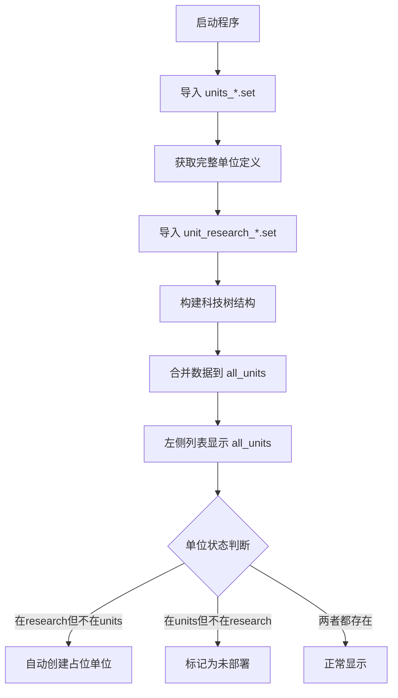
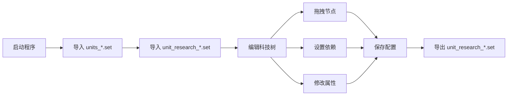

# Research Tree Generator - 长期记忆与知识库
# Research Tree Generator - Long-term Memory & Knowledge Base

**版本 / Version**: v2.2.2  
**最后更新 / Last Updated**: 2026-09-19  
**维护者 / Maintainer**: AI Assistant

> **语言说明 / Language note**：本文档是**内部开发知识库**，正文以中文为主，
> 标题与关键结论提供英文对照。面向使用者的双语文档为 [README.md](README.md)、
> [INSTALL.md](INSTALL.md)、[CONTRIBUTING.md](CONTRIBUTING.md)、[SECURITY.md](SECURITY.md)。
>
> This is an **internal development knowledge base**: body text is primarily Chinese,
> with English in headings and key conclusions. For user-facing bilingual docs see
> README / INSTALL / CONTRIBUTING / SECURITY.

> **v2.2.2 摘要（详见 §9.8）**：恢复重做（Ctrl+Y，五类动作全支持，并修掉"撤销自身清空重做栈"
> 的致命链路）、导出改为**原子写 + .bak 备份**、修复 `{positions}` 块被破坏、语言切换前增加
> **未保存数据保护**、版本号统一为 2.2.2、清理约 200 行死代码、i18n 新增 11 键（两侧各 262 键）、
> 测试 **101 → 135 个全部通过**、**初始化 git 仓库**。
>
> **开源整理（v2.2.2 发布前）**：改用 **MIT 许可**；移除含第三方 mod 配置的 `81work/`
> 与根目录样例（测试改用 `tests.write_sample_sets()` 生成的合成样例）；移除邮箱与私人署名、
> 文档本机路径改为相对路径；翻译键 262 → **260**（删掉 2 个个人信息键）；git 历史重写为
> **单一提交**，历史中不再含任何隐私信息。
>
> **v2.2.1 修复摘要（详见 §9）**：修掉 3 个确证功能性 Bug（撤销 KeyError、重叠检测 O(N³) 假性修复、
> 烧瓶图标恒假分支）、数据安全 4 项、网格吸附浮点噪声、41 处无守卫调试日志、
> i18n 缺口清零（两侧各 251 键）、测试 **40 → 101 个全部通过**、清理 11 份过时文档。
> 备份：`Research_Tree_Generator_backup_20260912_190938`。

---

## 📋 目录 / Table of Contents

1. [项目概述 / Project Overview](#1-项目概述--project-overview)
2. [核心架构 / Core Architecture](#2-核心架构--core-architecture)
3. [数据模型 / Data Models](#3-数据模型--data-models)
4. [文件格式规范 / File Format Specifications](#4-文件格式规范--file-format-specifications)
5. [开发规范 / Development Standards](#5-开发规范--development-standards)
6. [工作流程 / Workflows](#6-工作流程--workflows)
7. [常见问题与解决方案 / Common Issues & Solutions](#7-常见问题与解决方案--common-issues--solutions)
8. [最佳实践 / Best Practices](#8-最佳实践--best-practices)

---

## 1. 项目概述 / Project Overview

### 1.1 项目定位 / Project Positioning

**项目名称**: Gates of Hell - Research Tree Generator (科技树生成器)

**核心功能**:
- 🎯 解析 Scheme/Lisp 语法的 `.set` 配置文件
- 🌳 可视化编辑和管理科技树结构
- 🔗 处理单位依赖关系和拓扑排序
- 💾 支持导入/导出游戏配置文件
- 🎨 提供直观的拖拽式图形界面

**适用游戏**: Gates of Hell (GoH)

**技术栈**:
- **前端框架**: PyQt5 (Python GUI)
- **编程语言**: Python 3.14+
- **打包工具**: PyInstaller 6.19.0
- **算法基础**: 图论、拓扑排序、网格系统

### 1.2 品牌标识 / Brand Identity

**重要决策**: 项目品牌名称已从 "Company of Heroes" (CoH) 统一更改为 "Gates of Hell" (GoH)

**影响范围**:
- ✅ 窗口标题
- ✅ 关于对话框
- ✅ README 文档
- ✅ 启动脚本
- ✅ 所有用户可见文本

---

## 2. 核心架构 / Core Architecture

### 2.1 双文件加载机制 / Dual-File Loading Mechanism

**核心工作流**:



**数据结构**:
- `self.units`: 从 `units_*.set` 导入的基础单位列表
- `self.research_units`: 从 `unit_research_*.set` 导入的科技树单位
- `self.all_units`: 合并后的完整单位列表（用于显示）

**关键规则**:
1. 优先使用 `all_units` 进行列表显示
2. 新建单位时同时添加到 `units` 和 `all_units`
3. 仅导入 research 文件时，`all_units = research_units`

### 2.2 画布渲染系统 / Canvas Rendering System

**网格系统**:
- **逻辑单位**: 0.1×0.1 为一个单元格
- **视觉比例**: 横轴长度是纵轴的 2 倍 (2:1)
- **节点尺寸**: 
  - 编辑模式: 6×6 (美观优化)
  - 预览模式: 8×8 (接近游戏内实际大小 8.5×8.5)

**坐标转换**:
```python
# 逻辑坐标 → 像素坐标
pixel_x = logical_x * 40  # 横轴: 0.1 = 40px
pixel_y = logical_y * 20  # 纵轴: 0.1 = 20px
```

**节点绘制规则**:
- 边框颜色表示状态:
  - 🟢 绿色: 无前置单位（根节点）
  - 🔵 蓝色: 有前置单位
  - ⚪ 灰色: 已部署到画布
- 选中时显示 8×8 虚线网格
- 右上角显示烧瓶图标（科技单位）

### 2.3 智能连线系统 / Smart Connection System

**连线特性**:
- 红色虚线 (`#E74C3C`, 2px, DashLine)
- 带箭头指向子节点
- ZValue=5（在节点下方，避免遮挡）

**智能连接算法** (`_get_connection_point`):
```python
# 根据相对位置动态选择连接点
if child is to the right of parent:
    start = parent.right_edge
    end = child.left_edge
elif child is below parent:
    start = parent.bottom_edge
    end = child.top_edge
# ... 其他方向
```

**优势**:
- ✅ 连线不会穿过节点
- ✅ 拖动后自动更新
- ✅ 多父节点支持

---

## 3. 数据模型 / Data Models

### 3.1 Unit 类 / Unit Class

**字段定义**:
```python
@dataclass
class Unit:
    name: str                    # 单位名称
    unit_type: str = ""          # 类型: '' (单位) 或 'tech' (科技)
    side: str = ""               # 阵营
    costs: int = 4               # 成本（默认值）
    position_x: float = 0.0      # X 坐标
    position_y: float = 0.0      # Y 坐标
    requires: list = field(default_factory=list)  # 前置单位列表（支持多父节点）
    raw_definition: str = ""     # 原始定义字符串
    deployed: bool = False       # 是否已部署到画布
    in_research: bool = True     # 是否在 research 文件中
    period: str = ""             # 时期（如 era1960）
    squad_type: str = ""         # 单位分类（v1.29），从 units_*.set 括号内提取（如 squad_vehicle、offmap_support）
```

**关键方法**:
- `to_dict()`: 转换为字典
- `from_dict(data)`: 从字典创建（忽略未知字段，保持向后兼容）

### 3.2 多父节点支持 / Multi-Parent Node Support

**v1.27 核心特性**:

**格式规范**:
```scheme
// .set 文件格式
{ tech "child_unit" requires "parent1 parent2 parent3" costs 1 position 1 0}
```

**内部表示**:
```python
unit.requires = ["parent1", "parent2", "parent3"]
```

**转换规则**:
- **读取**: 按空格分割 → 列表
- **保存**: 用空格连接 ← 列表
- **显示**: 用空格连接 ← 列表
- **编辑**: 按空格分割 → 列表

**边界处理**:
- 空字符串 `""` → 空列表 `[]`
- 单个父节点 `"parent"` → `["parent"]`
- 多余空格 `"p1   p2"` → `["p1", "p2"]`（自动清理）

---

## 4. 文件格式规范 / File Format Specifications

### 4.1 .set 文件格式 / .set File Format

**语法特征**: 类 Scheme/Lisp 的 S-表达式

**基本结构**:
```scheme
{IconGap 28}

;// 注释行（以 ;// 开头）
;// REINFORCEMENTS & TECH LEVELS

// 科技节点
{ tech "name" requires "parent1 parent2" costs 1 position x y}

// 普通单位
{"unit_name" requires "parent" costs 2 position x y}

// Positions 块
{positions
    {"unit_name" x y}
}

// 包含其他文件
(include "other_file.set")
```

**注释规范**:
- ✅ 使用 `;//` 作为注释前缀
- ❌ 不使用 `;` 单独作为注释（会被解析器移除）
- 保留所有原始注释、空行、分隔线

### 4.2 单位类型定义 / Unit Type Definition

**类型来源优先级**:
1. **unit_research_*.set**: 决定最终类型（`tech` 或 `""`）
2. **units_*.set**: 提供补充信息（可能被覆盖）

**类型规则**:
- `{ tech "name" ... }` → `unit_type = "tech"`
- `{"name" ... }` → `unit_type = ""`（空表示普通单位）

**costs 字段**:
- 默认值: 4
- 优先使用 `unit_research_*.set` 中的值
- 输入验证: 必须为正整数

### 4.3 单位分类字段（squad_type）/ Unit Classification (squad_type)

**v1.29 新增**:

从 `units_*.set` 解析时提取 `squad_type`，用于左侧列表分组。

**标准格式提取**：
```python
# 从 properties 字符串中提取第一个引号词
# ("squad_vehicle" side(sov) period(era1960) ...)
squad_match = re.match(r'\s*"([^"]+)"', properties)
squad_type = squad_match.group(1) if squad_match else ""
```

**Conquest 格式（三种变体）**：

格式 1 — 标准 `{"name" ("type" ...)}` 块：
```
{"su-25sm_at" ("squad_vehicle" side(sov) ...)}
```
名称来自 `{"..."}`，squad_type 来自 properties 第一个引号词。

格式 2 — 仅 `side` 字段：
```
("squad_with4types_conquest" side(sov) name(squad_conscript_con) ...)
```
名称 = `name(值) + (side)` → `squad_conscript_con(sov)`

格式 3 — `side` + `nation` 字段：
```
("squad_with4types_conquest_warsaw" nation(gdr) side(sov) name(squad_kda) ...)
```
名称 = `name(值) + (nation)` → `squad_kda(gdr)`，nation 优先于 side

**实现注意**：
- Conquest 条目以 `("` 开头（非 `{"`）
- 通过 `content.split('\n')` 逐行处理，避免 `re.finditer` + `re.MULTILINE` 中 `^` 匹配到 `\n` 本身的问题
- 标准 `{...}` 块内的 `("type" ...)` 行不含 `name(` 字段，通过 `"name(" not in line` 过滤
- 使用 `nation` 字段优先于 `side` 作为后缀

### 4.4 文件编码 / File Encoding

**编码标准**: UTF-8

**读写规范**:
```python
# 读取
with open(filepath, 'r', encoding='utf-8') as f:
    content = f.read()

# 写入
with open(filepath, 'w', encoding='utf-8') as f:
    f.write(content)
```

---

## 5. 开发规范 / Development Standards

### 5.1 代码标注规范 / Code Annotation Standard

**AI 生成标注要求**:

所有代码修改必须添加 AI 生成标注：

```python
# ✅ AI 生成: 修复多父节点导出问题
requires_str = ' '.join(requires_list) if requires_list else ""

# ✅ AI 生成: 支持空格分隔的多父节点解析
requires_list = [r.strip() for r in req.split() if r.strip()] if req else []
```

**标注格式**:
- 使用 `# ✅ AI 生成:` 前缀
- 简要说明修改目的
- 放在修改代码上方

### 5.2 文档规范 / Documentation Standard

**README.md 维护策略**:

**唯一主文档**: 仅保留 `README.md`，删除其他冗余文档

**双语结构**:
```markdown
## 标题 / Title

- ✅ **英文描述 / English description**: [English text] / [中文文本]
```

**版本历史格式**:
```markdown
## v1.27 (2026-04-20)

**Category / 类别**:

### ✨ New Features / 新增功能

- ✅ **Feature / 功能名**: [English] / [中文]

### 🔧 Technical Improvements / 技术改进

- ✅ **Improvement / 改进项**: [English] / [中文]

### 🐛 Bug Fixes / Bug 修复

- ✅ **Fix / 修复项**: [English] / [中文]

### 📊 Testing / 测试验证

- ✅ Verified [test case] / 验证 [测试用例]
```

### 5.3 撤销功能规范 / Undo Function Standard

**实现要求**:
- 快捷键: `Ctrl+Z`
- 限制最大步数（防止内存溢出）
- 记录操作类型和前后状态

**示例**:
```python
undo_action = UndoAction(
    UndoActionType.MODIFY_PROPERTY,
    {
        'unit_name': unit_name,
        'property': 'costs',
        'old_value': old_value,
        'new_value': new_value
    }
)
self.undo_manager.push_action(undo_action)
```

### 5.4 国际化规范 / Internationalization Standard

所有用户可见字符串必须通过 `tr()` 翻译函数包装：

```python
# ✅ 正确
QMessageBox.information(self, tr('导入成功'), tr('成功导入 {count} 个单位').format(count=n))

# ❌ 错误 — 硬编码中文
QMessageBox.information(self, '导入成功', '成功导入 {count} 个单位'.format(count=n))
```

**包含 format 参数的翻译 key**：翻译 JSON 中的 key 必须包含完整的模板字符串（含 `{param}` 占位符），value 中也需保留占位符：
```json
{
  "成功导入 {count} 个单位\n阵营: {faction}": "Successfully imported {count} units\nFaction: {faction}"
}
```

**XML/HTML 不在翻译范围内**：仅包裹纯文本字符串，不包裹 HTML 标签或 XML。

### 5.5 导出保留格式规范 / Export Format Preservation

**核心原则**: 保留原始文件的完整格式结构

**必须保留**:
- ✅ 整行注释（`;// DOCTRINE TECHS`）
- ✅ 空行
- ✅ 分隔线
- ✅ 缩进和空格

**仅更新**:
- 单位数据行（name, requires, costs, position）

**实现方法**:
```python
def _export_with_original_format(self, units, faction, output_path, original_file_path):
    # 读取原始文件
    with open(original_file_path, 'r', encoding='utf-8') as f:
        original_lines = f.readlines()
    
    # 逐行处理，保留非单位行
    for line in original_lines:
        if is_comment_or_empty(line):
            result_lines.append(line)  # 直接保留
        elif is_unit_line(line):
            result_lines.append(format_unit_line(unit))  # 更新数据
        else:
            result_lines.append(line)  # 保留其他行
```

---

### 5.6 输入校验规则 / Input Validation Rules

**新建单位名称**：只允许字母、数字、下划线、括号、连字符、点：
```python
QRegExpValidator(QRegExp(r'^[a-zA-Z0-9_()\[\]\-\.]+$'))
```
禁止 `"`、`\`、`{`、`}`、`;`、空格、逗号——这些字符会破坏 `.set` 文件格式。

**Requires 输入**：禁止写入破坏文件格式的字符：
```python
QRegExpValidator(QRegExp(r'^[^"\,\{\}\\\;]*$'))
```
尤其逗号（`,`）是重点防范对象——用户习惯逗号分隔但系统按空格解析，逗号会被吞入单位名导致数据损坏。

**双保险校验**：QRegExpValidator 在输入时即时拦截 + post-accept 正则检查，防止验证器疏漏。

### 5.7 备份命名规范 / Backup Naming Convention

```
Research_Tree_Generator_v{version}_{Chinese_description}_{YYYYMMDD_HHMMSS}
```

示例：`Research_Tree_Generator_v1.29_单位分类系统与Conquest支持_20260524_193339`

## 6. 工作流程 / Workflows

### 6.1 标准工作流程 / Standard Workflow



### 6.2 节点交互流程 / Node Interaction Workflow

**拖拽节点**:
1. 鼠标按下 → 记录起始位置
2. 鼠标移动 → 实时更新节点位置
3. 鼠标释放 → 
   - 网格对齐
   - 重叠检测
   - 更新连线
   - 触发撤销记录

**设置依赖**:
1. 右键点击子节点 → "设置前置单位"
2. 点击父节点 → 建立依赖关系
3. 状态栏提示成功
4. 刷新连线和列表

**双击修改 Costs**:
1. 双击节点 → 弹出输入框
2. 输入新值 → 验证（正整数）
3. 确认 → 更新节点显示
4. 记录撤销操作

### 6.3 画布交互优化流程 / Canvas Interaction Optimization

**状态栏提示替代弹窗**:
```python
# ❌ 旧方式：阻塞式弹窗
QMessageBox.information(self, "提示", "已设置依赖")

# ✅ 新方式：非阻塞状态栏
self.statusBar().showMessage("✅ 已设置依赖", 3000)
```

**智能连线更新**:
- 拖动结束后自动调用 `update_edges()`
- 重新计算所有连线
- 确保连线跟随节点移动

---

## 7. 常见问题与解决方案 / Common Issues & Solutions

### 7.1 解析相关问题 / Parsing Issues

#### 问题 1: 多父节点只保存一个
**现象**: 导出后第二个及以后的父节点丢失

**原因**: `_format_unit_line_preserve_style()` 中只取了 `requires_list[0]`

**解决**:
```python
# ❌ 错误
requires_str = requires_list[0] if requires_list else ""

# ✅ 正确
requires_str = ' '.join(requires_list) if requires_list else ""
```

#### 问题 2: 分号注释被误删
**现象**: 导入后 `;` 开头的注释消失

**原因**: `_remove_comments()` 移除了所有 `;` 开头的行

**解决**: 区分 `;` 和 `;//`，仅移除纯 `;` 注释

### 7.2 显示相关问题 / Display Issues

#### 问题 3: 新建单位后列表只显示新单位
**现象**: 仅导入 research 文件时，新建单位后原有单位消失

**原因**: 刷新列表时使用 `self.units`（可能为空）而非 `self.all_units`

**解决**:
```python
# ❌ 错误
self.unit_list_panel.load_units(self.units)

# ✅ 正确
self.unit_list_panel.load_units(self.all_units)
```

#### 问题 4: 连线不显示
**现象**: 设置了依赖但看不到连线

**可能原因**:
1. 父节点不在 `nodes_dict` 中
2. `requires` 字段为空
3. 视图缩放导致连线在可视区域外

**排查步骤**:
```python
# 检查父节点是否存在
if req_name and req_name in nodes_dict:
    # 创建连线
else:
    print(f"Warning: Parent '{req_name}' not found")
```

### 7.3 国际化问题 / Internationalization Issues

#### 问题 5: 对话框显示中文而非英文
**现象**: 英文界面下，新建单位成功提示仍为中文

**原因**: 翻译文件中只有分散词汇，缺少完整消息模板

**解决**:
```json
// en_US.json
{
  "已创建{type} \"{name}\"\n\n新单位已添加到单位列表，\n双击列表项或拖拽到画布即可部署。": 
  "Created {type} \"{name}\"\n\nNew unit added to unit list,\ndouble-click list item or drag to canvas to deploy."
}
```

### 7.4 UI 交互问题 / UI Interaction Issues

#### 问题 6: 切换节点时 unit_type 被意外修改
**现象**: 非科技节点在导出后变成 `{ tech "name"...}` 格式

**原因**: `PropertyPanel.load_unit()` 中 `type_combo` 缺少 `blockSignals(True/False)`。切换节点时 `setCurrentText()` 触发 `currentTextChanged` → `on_property_changed`，此时 `current_unit_data` 仍指向**上一个**节点的数据，导致上一个节点的 `unit_type` 被覆盖。

**解决**:
```python
# ✅ 所有可编辑控件必须用 blockSignals 保护
self.type_combo.blockSignals(True)
self.type_combo.setCurrentText('tech' if unit_type == 'tech' else '')
self.type_combo.blockSignals(False)
```

#### 问题 7: 节点高亮残留
**现象**: 点击节点 B 时，节点 A 的金色边框和 A 的父节点紫色高亮不消失

**原因**: `itemChange(ItemSelectedChange, False)` 中调用 `check_node_overlaps()`，但编辑模式下该方法直接 return。`unhighlight_as_parent()` 在有 view 引用时也只调用 `check_node_overlaps()` 而不调用 `set_pen_and_brush()`。

**解决**:
- `itemChange(False)`: 在 `check_node_overlaps()` 后总是调用 `self.set_pen_and_brush()`
- `unhighlight_as_parent()`: 直接调用 `set_pen_and_brush()` 恢复默认样式，不依赖 overlap check 的副作用

### 7.5 性能相关问题 / Performance Issues

#### 问题 9: 撤销操作导致内存泄漏
**现象**: 长时间使用后程序变慢

**原因**: 无限制堆积撤销记录

**解决**:
```python
class UndoManager:
    def __init__(self, max_steps=50):
        self.max_steps = max_steps
        self.history = []
    
    def push_action(self, action):
        self.history.append(action)
        if len(self.history) > self.max_steps:
            self.history.pop(0)  # 移除最旧的记录
```

#### 问题 10: 画布网格扩展导致全量节点重建
**现象**: 导入 500+ 节点后拖动节点到边界时严重卡顿

**原因**: `_update_scene_rect()` 在网格需要扩展时调用 `scene.clear()` + `nodes.clear()`，然后遍历所有节点数据重新创建 `TechTreeNode` 和连线。

**解决**:
```python
# ✅ 保存网格项引用，只移除网格不重建节点
self.grid_items = []  # 在 draw_grid() 中追踪

def _update_scene_rect(self):
    if needs_resize:
        for item in self.grid_items:
            self.scene.removeItem(item)
        self.grid_items.clear()
        self.scene.setSceneRect(...)
        self.draw_grid()
        self.scene.update_edges(self.nodes)  # 仅刷新连线
```

#### 问题 11: Conquest 条目被 `re.finditer` + `re.MULTILINE` 跳过
**现象**: `("squad_weaponteam_conquest" ...)` 条目在解析后缺失

**原因**: `re.finditer(r'^\s*\(...', content, re.MULTILINE)` 中 `^` 匹配在 `\n` 位置，`content.find('\n', ls)` 找到同一个 `\n`，导致 `line = ""`。

**解决**: 改用 `content.split('\n')` 逐行处理，避免 `finditer` 位置歧义。

---

## 8. 最佳实践 / Best Practices

### 8.1 数据处理最佳实践 / Data Processing Best Practices

**1. 始终使用 all_units 进行显示**
```python
# ✅ 推荐
self.unit_list_panel.load_units(self.all_units)

# ❌ 避免
self.unit_list_panel.load_units(self.units)  # 可能不完整
```

**2. 多父节点统一使用空格分隔**
```python
# 读取
requires_list = req.split() if req else []

# 保存
requires_str = ' '.join(requires_list)

# 显示
self.requires_input.setText(' '.join(requires_list))
```

**3. 类型安全的数据转换**
```python
# ✅ 安全检查
if isinstance(requires, list):
    requires_str = ' '.join(requires)
else:
    requires_str = requires if requires else ""
```

### 8.2 导出器最佳实践 / Exporter Best Practices

**1. 去重用 name 而非对象引用**
```python
# ❌ 错误 — Unit 含 list 字段不可 hash
already_grouped = set(techs + doctrines + radios)

# ✅ 正确 — 用 name 字符串
already_grouped_names = {u.name for u in techs + doctrines + radios}
others = [u for u in others if u.name not in already_grouped_names]
```

**2. 所有导出方法 tab 数应一致**
```python
# 确保 _format_tech_line / _format_unit_line / _format_unit_line_preserve_style
# 中 costs 前的 tab 数一致
```

### 8.3 UI 交互最佳实践 / UI Interaction Best Practices

**1. 使用状态栏而非弹窗**
```python
# ✅ 非阻塞提示
self.statusBar().showMessage("✅ 操作成功", 3000)

# ❌ 阻塞式弹窗（频繁使用时）
QMessageBox.information(self, "提示", "操作成功")
```

**2. 信号阻塞避免递归更新**
```python
# ✅ 阻止信号避免触发 on_property_changed
self.costs_spinbox.blockSignals(True)
self.costs_spinbox.setValue(new_value)
self.costs_spinbox.blockSignals(False)
```

**特别注意 `QComboBox`**：`setCurrentText()` 会触发 `currentTextChanged` 信号，必须在所有可编辑控件（包括下拉框）的 `setCurrentText`/`setValue` 前后使用 `blockSignals`：

```python
self.type_combo.blockSignals(True)
self.type_combo.setCurrentText('tech')
self.type_combo.blockSignals(False)
```

**3. 深拷贝避免引用污染**
```python
import copy
self.current_unit_data = copy.deepcopy(unit_data)
```

### 8.4 文件导入最佳实践 / File Import Best Practices

**1. 多文件导入使用 `getOpenFileNames`**
```python
# ✅ 支持 Ctrl+Click 多选
file_paths, _ = QFileDialog.getOpenFileNames(...)

# ❌ 只能单选
file_path, _ = QFileDialog.getOpenFileName(...)
```

**2. 仅统计实际成功导入的文件**
```python
total_files_imported = 0
for file_path in file_paths:
    if not validate(file_path):
        continue  # 不计数
    try:
        parse(file_path)
        total_files_imported += 1  # 成功后才计数
    except:
        pass
```

### 8.5 文件操作最佳实践 / File Operation Best Practices

**1. 始终指定 UTF-8 编码**
```python
# ✅ 明确编码
with open(filepath, 'r', encoding='utf-8') as f:
    content = f.read()
```

**2. 保留原始格式导出**
```python
# ✅ 传递原始文件路径
exporter.export(units, faction, output_path, original_file_path)
```

**3. 备份原文件**
```python
import shutil
shutil.copy(original_file, backup_file + '.bak')
```

### 8.4 测试最佳实践 / Testing Best Practices

**1. 覆盖边界情况**
- 空值测试
- 单值测试
- 多值测试
- 多余空格测试

**2. 样例文件验证**
```python
from tests import make_test_dir, remove_test_dir, write_sample_sets

def test_parse_sample_file(self):
    tmp = make_test_dir()
    try:
        research, units = write_sample_sets(tmp)   # 代码生成的合成样例
        data = parser.parse_research_file(research)
        # 验证实际数据
    finally:
        remove_test_dir(tmp)
```

> ⚠️ 开源仓库不存放第三方 mod 的 `.set` 文件。样例由 `tests/__init__.py` 生成，
> 只保留解析器需要的语法结构。

**3. 往返一致性测试**
```python
# 导入 → 导出 → 对比
parser.parse(input_file)
exporter.export(units, output_file, input_file)
assert files_are_equal(input_file, output_file)
```

---

## 📚 附录 / Appendix

### A. 常用快捷键 / Common Shortcuts

| 快捷键 / Shortcut | 功能 / Function |
|------------------|----------------|
| Ctrl+U | 导入 units_*.set |
| Ctrl+R | 导入 unit_research_*.set |
| Ctrl+S | 保存科技树配置 |
| Ctrl+Z | 撤销上一步操作 |
| Ctrl++ | 放大画布 |
| Ctrl+- | 缩小画布 |
| Ctrl+0 | 重置缩放 |
| 鼠标中键 | 拖动画布视图 |
| Enter | 确认属性修改 |
| ESC | 取消设置前置单位模式 |

### B. 文件结构 / File Structure

```
Research_Tree_Generator/
├── main.py                    # 入口文件
├── src/                       # 源代码
│   ├── parser.py              # 解析器
│   ├── exporter.py            # 导出器
│   ├── main_window.py         # 主窗口
│   ├── tech_tree_canvas.py    # 科技树画布
│   ├── property_panel.py      # 属性面板
│   ├── unit_list_panel.py     # 单位列表面板
│   └── translations/          # 翻译文件
│       ├── zh_CN.json
│       └── en_US.json
├── tests/                     # 单元测试
│   ├── __init__.py            # 临时目录工具
│   ├── test_multi_parent_nodes.py  # 多父节点（20）
│   ├── test_undo_export.py         # 撤销/导出（20）
│   ├── test_fixes_v221.py          # v2.2.1 回归（61）
│   ├── test_fixes_v222.py          # v2.2.2 回归（34）
│   └── README_TESTS.md
├── dist/                      # 本地构建产物（.gitignore，不入库）
├── .git/                      # Git 仓库（v2.2.2 初始化）
├── .gitattributes             # 换行/二进制策略
├── LICENSE                    # MIT
├── README.md                  # 主文档
├── INSTALL.md                 # 安装指南
├── LONG_TERM_MEMORY.md        # 本知识库
├── requirements.txt           # 依赖清单
└── run_tests.bat              # 测试脚本
```

> 说明：早期版本曾附带 `81work/` 样例目录（含第三方 mod 的 `.set` 文件）。
> 为避免分发第三方素材，该目录已移除；测试改用 `tests.write_sample_sets()` 生成的合成样例。

### C. 版本历史摘要 / Version History Summary

**v2.2.2 (2026-09-19)**: 恢复重做（Ctrl+Y）、导出原子写 + `.bak` 备份、`{positions}` 块保护、语言切换数据保护、死代码清理、git 初始化、测试 101 → 135  
**v2.2.1 (2026-09-12)**: 撤销 KeyError、防抖 O(N³)、烧瓶图标、网格吸附、数据安全、i18n 251 键、测试 40 → 101  
**v2.2 (2026-07-10)**: 注释风格修复（`//` → `;//`）  
**v1.29 (2026-05-24)**: 单位分类系统、Conquest 格式支持、多文件导入  
**v1.28 (2026-05-24)**: 节点高亮修复、输入校验增强、画布性能优化、单元测试  
**v1.27 (2026-04-20)**: 多父节点完整支持  
**v1.26 (2026-04-16)**: 烧瓶图标优化、条件编译  
**v1.15 (2026-04-12)**: 双模式切换（编辑/预览）  
**v1.14 (2026-04-11)**: 鼠标中键平移、打包规范

---

## 9. 代码审计与修复记录 / Code Audit & Fix Log

**版本 / Version**: v2.2.2（2026-09-19；v2.2.1 审计见 §9.1–§9.7，v2.2.2 本轮见 §9.8）  
**备份 / Backup**: `Research_Tree_Generator_backup_20260912_190938`（v2.2.1 快照）  
**版本控制 / VCS**: 项目内已 `git init`，首个提交 `4f27104` = v2.2.1 基线（49 文件），此后每次修改独立提交

### 9.1 已修复的功能性缺陷 / Fixed Functional Defects

#### ✅ 问题 12: 撤销 MODIFY_PROPERTY 键名不对称（属性面板改 Costs 无法撤销）
- **位置**: `src/main_window.py`（原 `update_unit_in_canvas` 写 `'property_name'`，`perform_undo` 读 `action.data['property']`）
- **现象**: 抛 `KeyError` → 被外层 `except` 吞掉，只显示"❌ 撤销失败"。画布双击改 Costs 可撤销，属性面板改 Costs 不可撤销。
- **解决**: 读取时兼容两种键名
  ```python
  property_name = action.data.get('property', action.data.get('property_name', 'costs'))
  ```

#### ✅ 问题 13: `_schedule_overlap_check` 防抖为**假性修复**，实为 O(N³)
- **位置**: `src/tech_tree_canvas.py` `_schedule_overlap_check()`
- **根因**: PyQt5 的 `QTimer.singleShot()` 是**静态方法，恒返回 `None`**。
  ```python
  # ❌ 原实现：self._overlap_timer 永远为 None → stop() 分支是死代码
  self._overlap_timer = QTimer.singleShot(0, self.check_node_overlaps)
  ```
  `add_unit_node` / `update_unit_node` 每建一个节点排一次单次定时器 → 每个回调都跑完整 O(N²) 检测 → **加载 N 节点总代价 O(N³)**。
- **解决**: 持有真正的 QTimer 实例并 `setSingleShot(True)`，同一事件循环内多次调用合并为一次
  ```python
  # ✅ 正确
  if self._overlap_timer is None:
      self._overlap_timer = QTimer(self)
      self._overlap_timer.setSingleShot(True)
      self._overlap_timer.timeout.connect(self.check_node_overlaps)
  self._overlap_timer.stop()
  self._overlap_timer.start(0)
  ```
- **⚠️ 教训**: 静态 `singleShot` 与实例 `QTimer` 语义不同，`stop()` 只能作用于后者。

#### ✅ 问题 14: `update_from_unit` 烧瓶图标更新为恒假分支
- **位置**: `src/tech_tree_canvas.py` `update_from_unit()`
- **根因**: 先 `self.unit = unit` 再取 `old_unit_type = getattr(self.unit, 'unit_type')` → old 与 new 必然相等 → `if` 恒假。
- **现象**: 单位在 `''` ↔ `'tech'` 间切换类型时，烧瓶图标既不清除也不绘制。
- **解决**: 调整赋值顺序，先取旧类型再覆盖 `self.unit`。

#### ✅ 问题 15: 保存后脏位不复位 + 关闭窗口不校验保存结果
- **位置**: `src/main_window.py` `save_tech_tree()` / `closeEvent()`
- **现象**: `has_unsaved_changes` 从不复位 → 每次关闭都误报"未保存"；选 Save 后直接 `event.accept()`，**在保存对话框点取消窗口照样关闭 → 静默丢数据**。
- **解决**: `save_tech_tree()` 改为返回 `bool`（取消/失败返回 False，成功时复位脏位并记住输出路径）；`closeEvent` 仅在返回 True 时 `accept()`。

#### ✅ 问题 16: `all_units` 别名导致列表重复行
- **位置**: `src/main_window.py`
- **根因**: `self.all_units = self.units`（别名，同一 list），而 `add_new_unit` 又向 `self.units` 和 `self.all_units` 各 append 一次 → 同一 Unit 对象出现两次。
- **解决**: 三处改用 `list(...)` 取副本；`add_new_unit` 只向 `all_units` append 一次（`parser.add_custom_unit` 已负责 parser 侧）。

#### ✅ 问题 17: 清空/新建科技树不清撤销栈
- **现象**: `clear_all_data()` 提示"不可撤销"却未调 `undo_manager.clear()` → 清空后仍能"撤销"出幽灵单位。
- **解决**: `clear_all_data` / `new_research_tree` 均调用 `undo_manager.clear()`。

#### ✅ 问题 18: 按下即对齐造成的静默数据/视觉分叉
- **位置**: `src/tech_tree_canvas.py` `mousePressEvent` / `mouseReleaseEvent`
- **根因**: 按下时 `setPos` 对齐网格但**不写回 `unit.position_*`、不记撤销**；释放时只有 `snapped != current` 才回写。对非网格坐标（面板允许 0.35）单击一下就"画在 0.4、数据仍 0.35"，且该偏移**永远进不了撤销栈**。
- **解决**: 移除按下时的对齐，只记录真实初始位置；吸附统一在释放时完成并**无条件同步写回 unit**（吸附幂等，位置未变时写回同值）；撤销记录改用按下时快照的 unit 真实逻辑坐标。

#### ✅ 问题 19: `draw_grid` 恒从绝对原点绘制导致网格/标尺错位
- **根因**: `draw_grid` 从 (0,0) 起画，而 `_update_scene_rect` 可能把 sceneRect 原点设为 `min_x>0`；且两个分支的 sceneRect 口径不同（一个含边距、一个含 `max_x-min_x`）。
- **解决**: 新增 `grid_origin_x / grid_origin_y`，`draw_grid` 以该原点绘制（标尺读数仍为整齐量纲值）；`_update_scene_rect` 原点向下对齐到 40px 网格倍数，两个分支统一口径，原点变化同样触发重绘。

#### ✅ 问题 20: 测试环境健壮性（40 个用例曾全部误报 error）
- **根因**: ① `tearDown` 的 `shutil.rmtree` 在目录被占用时抛 `PermissionError`；② `tempfile.mkdtemp()` 把目录权限收紧为 0700，在受限 ACL 下反而导致写入被拒。
- **解决**: `tests/__init__.py` 提供 `make_test_dir()` / `remove_test_dir()`（用 `os.makedirs` + uuid，不用 mkdtemp；清理用 `ignore_errors=True`）；测试临时根目录解析到项目内 `.test_tmp/`（可用 `RTG_TEST_TMP` 覆盖）。
- **结果**: `python -m unittest discover -s tests` → **Ran 40 tests, OK**（此前 23 errors）。

### 9.2 国际化 / i18n 修复

- **缺口清零**: 以源码 `tr()` 字面量为基准比对，补齐 **缺中文 50 键 + 缺英文 32 键**；删除 2 个陈旧中文键与 1 个陈旧英文键。
- **结果**: `zh_CN.json` 与 `en_US.json` **各 251 键，完全对齐**（此前 203 / 220，英文界面大量中文残留）。
- **修复互译对调**: `"语言(&L)"` 原在 zh 文件里是 `"Language(&L)"`、在 en 文件里是 `"语言(&L)"`，现已各自修正。
- **修复失效查询**: 代码查询的 `'导入 units.set 文件（可多选）'` 原先两文件都不存在（英文模式对话框标题保持中文），现已补齐。
- **⚠️ 规范提醒**: `tr()` 的 key 是**完整模板字符串（含 `{placeholder}`）**；带占位符的译文必须保留同名占位符，否则 `.format()` 抛 `KeyError`。
- **校验方法**: `python test_imports.py` 现在包含 i18n 键集一致性断言。

### 9.3 性能与清理

- `check_node_overlaps` 内所有 `debug_print(f"...")` 改为 `if debug.DEBUG:` 短路——**f-string 在 DEBUG=False 时不再组装**；移除与 DEBUG 无关的无条件 `sys.stdout.flush()`（原实现每次检测有 5 处）。
  - ⚠️ 必须写 `if debug.DEBUG:`（模块属性），**不能写 `if DEBUG:`**（import 期快照，不随环境变量更新）。
- 重叠高亮改为**增量重绘**：仅当 `is_overlapping` 或 `highlighted_edges` 真正变化时才调 `set_pen_and_brush()`（该方法会 `removeItem`/`addItem` 重建高亮边线）。
- 删除 11 份过时/无效文档（见 §9.4）；补 `requirements.txt`（`run.bat` 原先引用它但文件不存在，自动安装分支必然失败）。

### 9.4 文档清理结果 / Documentation Cleanup

**保留**（3 份，版本一致为 v2.2/2.2.1）：
| 文档 | 作用 |
|------|------|
| `README.md` | 唯一主文档（中英双语使用说明 + 版本历史） |
| `INSTALL.md` | 安装指南 |
| `LONG_TERM_MEMORY.md` | 本文件（知识库） |

**已删除**（11 项，均可从备份还原）：
`PROJECT_SUMMARY.md`(v1.0.0，代码统计 ~1500 行 vs 实际 ~6000 行) ·
`QUICKSTART.md`(v2.1) · `使用说明.md`(v2.1) · `测试用例.md`(v1.28) ·
`黑盒测试用例.md`(v1.28) · `TESTING_GUIDE.md`(遗留开发笔记) ·
`tests/TEST_REPORT.md`(v1.27) · `教学视频字幕.md`(v2.1) · `对话记录.md`(历史归档) ·
`dist/教学.md`(0 字节) · `dist/使用方法：把README.md喂给AI你问AI.txt`(0 字节)

> 已同步从 `Research_Tree_Generator.spec` 的 `datas` 中移除被删文档，并加入 `LONG_TERM_MEMORY.md`。

### 9.5 其他修复

| 项 | 说明 |
|---|---|
| 关于框版本号 | `main_window.py` 原硬编码 `2.1`，与 `main.py`/`spec` 的 `2.2` 不一致 → 改为 `2.2` |
| `_extract_faction` 正则 | `units_(\w+)\.set` 把 `units_sov_era1960.set` 解析成 faction=`sov_era1960`（把时期当阵营）→ 改为 `units_([a-z]+)`，现得 `sov` |
| `unit.requires = ""` | `new_research_tree` 原将 requires 重置为空**字符串**，与 list 契约不一致 → 改为 `[]` |
| 重名检查 | `add_new_unit` 只查 `self.units`，漏掉 research-only 单位 → 改为查 `self.all_units` |
| `.gitignore` | `*.json` 规则会把 `src/translations/*.json` 一并忽略（翻译文件丢失风险）→ 加 `!language_config.json` 与 `!src/translations/*.json`；新增 `.test_tmp/` |
| `test_imports.py` | 依赖不存在的 `example_units_usa.set`、含阻塞式 `input()`、只捕 `ImportError`、漏 4 个模块、Windows GBK 下 emoji 抛 `UnicodeEncodeError` → 全部重写 |
| `run.bat` 引用 | 补 `requirements.txt`（内容仅 `PyQt5>=5.15.0`） |

### 9.5 单元测试补强与测试驱动发现的缺陷

**新增 `tests/test_fixes_v221.py`（61 个测试）**，为上面每一项修复建立回归保护。
写测试的过程中又**发现并修复了 3 个此前未察觉的缺陷**：

#### ✅ 问题 21: 网格吸附在边界上方向不可预测（浮点噪声）
- **位置**: `src/tech_tree_canvas.py` `mouseReleaseEvent`
- **现象**: 量纲 `0.35` 对应像素 `139.99999999999997`，`round(139.99999999999997 / 40)` = `round(3.4999…)` 得 **3** 而非 4 → 节点被吸附到 **0.3**（反直觉，用户拖到 0.35 会跳到 0.3）。
- **根因**: 在**像素域**做 `round(px / grid)`，网格边界上的浮点误差会翻转取整方向。
- **解决**: 新增 `snap_logical_to_grid()`，在**量纲域**取整（`round(0.35 * 10) / 10 = 0.4`），彻底消除边界不确定性；像素位置由量纲值反算，保证画布与数据同源。
  ```python
  # ❌ 旧：像素域取整，0.35 -> 0.3
  snapped_x = max(0, round(current_pos.x() / 40) * 40)
  # ✅ 新：量纲域取整，0.35 -> 0.4
  gx, gy = self.snap_logical_to_grid(node.unit.position_x, node.unit.position_y)
  snapped_x, snapped_y = gx * 400.0, gy * 200.0      # 1.0 量纲 = 400px / 200px
  ```

#### ✅ 问题 22: `main_window` 撤销路径的调试日志无 DEBUG 守卫
- **位置**: `src/main_window.py`（`update_unit_position_in_panel` / `_process_single_unit_move` 等）
- **现象**: 22 处 `debug_print(f"...")` 完全无守卫 —— `DEBUG=False` 时 f-string 仍被组装。这些函数在**框选多节点拖动**时按单位逐个调用，是真实热路径。
- **解决**: 用 AST 精确定位全部 41 处未守卫调用（涉及 `main_window` / `property_panel` / `tech_tree_canvas` / `undo_manager`），按「行号连续 + 缩进相同」成组插入 `if debug.DEBUG:`，并补齐 3 个模块缺失的 `from src import debug`。

#### ✅ 问题 23: `parse_file` 的格式判定依赖文件名（易被误解）
- **现象**: 导出到不含 `unit_research` 前缀的文件名（如 `rt.set`）后再解析，会得到 **0 个单位** —— 因为 `parse_file` 用文件名判断格式，落到了 `parse_units_file` 分支。
- **现状**: 这是**既有设计**而非缺陷（保存对话框默认名 `unit_research_{faction}.set` 恰好正确），本轮不改行为，但已加测试固化该契约，避免后续误判为 Bug。

### 9.6 测试环境修复（40 → 101 个测试全部通过）

| 项 | 说明 |
|---|---|
| 临时目录 | `tests/__init__.py` 提供 `make_test_dir()` / `remove_test_dir()`；用 `os.makedirs`+uuid（**不用 `tempfile.mkdtemp`** —— 它会把权限收紧为 0700，在受限 ACL 下反而拒绝写入），根目录为项目内 `.test_tmp/`（`RTG_TEST_TMP` 可覆盖） |
| 清理失败 | `remove_test_dir` 用 `ignore_errors=True`，清理失败不计为测试失败（原 40 个用例因此全部误报 23 errors） |
| 离屏运行 | `test_fixes_v221.py` 自行设置 `QT_QPA_PLATFORM=offscreen`，可直接在 CI/无显示环境运行 |
| 弹窗拦截 | `StubMessageBox` 替换 `main_window.QMessageBox`，避免模态框阻塞；常量从**真实** `QMessageBox` 抓取（`Discard = Save|Cancel` 是组合标志位，不能硬编码） |
| 检测器 | `TestDebugShortCircuit` 用 **AST 结构级**判断守卫，而非文本扫描 —— 文本扫描会误判「`if debug.DEBUG:` 下嵌套 for/if 的合法写法」和「docstring 中提及 `QTimer.singleShot`」 |
| 脚本 | `run_tests.bat` 现依次跑 3 个测试文件 + `test_imports.py` 自检；`tests/README_TESTS.md` 已更新 |

**结果**: `python -m unittest discover -s tests` → **Ran 101 tests, OK**

### 9.7 遗留问题跟踪 / Known Issues Tracker

> 本节由 v2.2.1 的"未修改问题"清单升级为跟踪表。v2.2.2 已解决第 1–4、8（部分）、9、12 项（详见 §9.8）。

**✅ 已解决 / Resolved in v2.2.2**
1. ~~重做功能不可用~~ → **已恢复** Ctrl+Y + 菜单，五类动作全支持，并修掉"撤销自身清空重做栈"的链路（§9.8）。
2. ~~`is_being_dragged` 写 6 读 0~~ → 类变量与全部赋值已删除。
3. ~~`update_position` 定义两次~~ → 仅保留一份（因 `itemChange` 已无条件 `return value`，其网格对齐副作用早已失效，一并去除）。
4. ~~约 400 行其他死代码~~ → 已删除 `add_unit_to_canvas`（死信号唯一处理者）、`on_undo_shortcut`、画布 `load_units`、`rebuild_ui`×2、`export_positions_only`、`i18n.reload_translations`、`language_changed`、`unit_dropped` 死信号、"✏️ 编辑属性"菜单项、`self.units_file`。
9. ~~无备份 / 非原子写~~ → 导出改为**临时文件 + `os.replace` 原子替换**，并自动生成 `.bak`；写失败时清理临时文件且原文件完好（§9.8）。
12. ~~git 仓库无 commit~~ → 已 `git init` 并提交 v2.2.1 基线（`4f27104`）。

**⚠️ 仍遗留 / Still open**
5. **`_get_connection_point` 退化情形**：两节点中心重合时双方都取左边缘 → 零长线 + 反向箭头。
6. **重叠判定阈值与节点比例不匹配**：节点高 120px（=6 个 Y 格），但垂直"完全重叠"阈值仅 40px → 同列相距 ≤0.5 量纲会误报全红。
7. **`check_node_overlaps` 仍是 O(N²)**（无空间索引/网格哈希），且 `itemChange` 取消选中会触发全量检测 → 预览模式下每次点击可能放大为 O(N³) 级别的节点重绘。
8. **（部分修复）** `export_positions_only` 已删除、`{positions}` 块不再被破坏；但 `_export_with_original_format` 对"不在 units 列表中的单位行"仍原样保留 → **画布上删除节点后保存，该行仍会"复活"**（属"保留未知行"的既有取舍，需产品决策）。
10. **`PortraitManager._cache` 无上限**且 `load_folder` 刻意不清空；类级单例 `TechTreeCanvas.portrait_manager` 为全局可变状态。
11. 属性面板 `pos_*_spinbox` 上限 100，而画布位置可无限增长；面板位置编辑仍被 `update_unit_in_canvas` 覆盖（"🔄 重置位置"对画布无效）。
13. **撤销路径不置脏位**：保存后再撤销，`has_unsaved_changes` 仍为 False（关闭时不提示保存）。重做路径已置 True；撤销路径待补齐。
14. 三份数据源（`units` / `all_units` / `canvas.nodes`）靠手写循环同步，仍是重复行/不同步类 bug 的结构性温床（建议引入单一数据模型，见 §8）。

### 9.8 v2.2.2 修复记录 / v2.2.2 Fix Log（2026-09-19）

**范围 / Scope**：恢复重做、导出安全、语言切换数据保护、死代码清理、文档与版本号统一。

#### ✅ 问题 24: 重做功能被整体注释，且实现后仍不可用（撤销自身清空重做栈）
- **位置**: `src/main_window.py`（`perform_redo` 约 125 行注释；`add_unit_to_canvas*` 的 ADD_UNIT 压栈；`perform_undo`）+ `src/tech_tree_canvas.py`（`on_item_deleted`）
- **根因（两层）**：
  1. `perform_redo` 与 Ctrl+Y 快捷键、菜单项全被注释，`UndoManager.redo()` 无调用者。
  2. 即使恢复实现，**撤销 ADD_UNIT 分支内部调用 `on_item_deleted(node)`**，而该方法会经 `unit_delete_for_undo` 信号压入一个新的 `DELETE_UNIT` 动作；`push_action` 内部 `redo_stack.clear()` → **刚压入的重做动作被清空**，Ctrl+Y 永远无效。
- **解决**：
  ```python
  # canvas
  def on_item_deleted(self, item, record_undo=True): ...
      if record_undo and hasattr(self, 'unit_delete_for_undo'):
          self.unit_delete_for_undo.emit(unit_data)
  # main_window
  self.tech_tree_canvas.on_item_deleted(node, record_undo=False)   # undo(ADD) 与 redo(DELETE) 各一处
  ```
- **顺带修复**：ADD_UNIT 压栈由 `{'unit_name'}` 扩展为 `{'unit_name', 'unit_data'}`，使 redo 能恢复完整单位；重做实现修复了旧注释代码的 3 处失效 API（`requires_text`/`update_display`/`', '.join`）与 `property`/`property_name` 双键名兼容。
- **回归**: `tests/test_fixes_v222.py::TestRedo*`（含 `test_undo_add_keeps_redo_available`）。

#### ✅ 问题 25: 导出非原子写 + 无备份（可损坏 mod 源文件）
- **位置**: `src/exporter.py`（`_export_simple` / `_export_with_original_format` 直接 `open(path,'w')`）
- **根因**: 输出路径通常等于原始文件，写入中途异常（崩溃/断电/磁盘错误）会截断并损坏源文件；且无备份可回滚。
- **解决**: 新增 `_write_file_safely()`：① 现有文件复制为 `.bak`；② 写同目录 `.rtg_tmp`；③ `os.replace()` 原子替换；失败时删除临时文件并重新抛出（原文件完好）。所有导出路径统一走该方法。`.gitignore` 忽略 `*.rtg_tmp`（`*.bak` 原有）。
- **回归**: `TestExporterSafeWrite`（备份内容=旧版本、首次保存无 `.bak`、`os.replace` 失败时原文件不变且无临时残留）。

#### ✅ 问题 26: `{positions}` 块被保留格式导出破坏
- **位置**: `src/exporter.py` `_export_with_original_format`
- **根因**: `_parse_unit_line` 把 `{positions}` 块内 `{"unit" x y}` 行按 `\{"([^"]+)"` 识别为单位行；若该单位在 `units_dict` 中，会被改写为完整 `requires/costs/position` 行 → 块语法破坏（真实样本 `81work/old/*.set` 含该块）。
- **解决**: 增加 `in_positions_block` 状态机，进入 `{positions` 后所有行原样保留，直到顶格 `}` 结束。
- **回归**: `TestPositionsBlockPreserved`（块内行零改写、不注入 requires/costs、仅存在于块内的单位行保持原样）。

#### ✅ 问题 27: 切换语言静默丢弃未保存数据
- **位置**: `src/main_window.py` `switch_language`
- **根因**: `os.execl()` 直接替换进程，**不经过 `closeEvent`** → 未保存更改无提示丢失；且点选当前语言也会重启；frozen 分支 `os.execl(python, python, script)` 把 exe 路径当多余参数传递。
- **解决**: 切换前若 `has_unsaved_changes` 则弹 Save/Discard/Cancel（Save 必须 `save_tech_tree()` 返回 True 才继续）；已是当前语言直接返回；frozen 分支改为 `os.execl(python, python)`。
- **回归**: `TestLanguageSwitchGuard`（Cancel/保存取消均不重启；Discard/无更改才重启且不弹框；同语言 no-op）。

#### 🧹 问题 28: 死代码清理（约 200 行）
- `TechTreeNode.is_being_dragged` 类变量及全部写入（详见 §9.7-2）
- 重复的 `update_position` 定义（§9.7-3）
- 死信号 `unit_dropped` 及其唯一处理者 `add_unit_to_canvas`（全仓库无 `emit`；实际拖拽走 `dropEvent → unit_dropped_at_position`）
- `on_undo_shortcut`、画布 `load_units`、`rebuild_ui`×2、`export_positions_only`、`i18n.language_changed` / `reload_translations`、无处理分支的"✏️ 编辑属性"菜单项、只写不读的 `self.units_file`
- **回归**: `TestDeadCodeRemoval`（源码级断言，防止回潮）。

#### 🌐 i18n / 版本 / 测试
- 新增 11 个翻译键（重做提示 + 语言切换确认），`zh_CN.json` / `en_US.json` **各 262 键、完全对齐**。
  **开源整理后为 260 键**：删除了 2 个仅用于个人联系信息的键（作者化名与邮箱标签）。
- 版本号统一为 **2.2.2**：`main.py`、关于对话框、`Research_Tree_Generator.spec`。
- 新增 `tests/test_fixes_v222.py`（**34 个测试**）→ 全量 **101 → 135，全部通过**。`run_tests.bat` 增加第 4 步。
- **Git**: 项目内 `git init`（`core.autocrlf false` 防止换行被改写）。
  **开源整理后历史重写为单一提交**，不再包含邮箱 / 本机路径等历史泄露。

### 9.9 开源发布准备 / Open-source Release Prep

**本地备份**：项目同级目录下 `Research_Tree_Generator_backup_<时间戳>_预上传GitHub`
（913 文件 / 494.1 MB，含旧 `.git`、`build/`、`dist/` 全部历史产物，可完整还原）

#### 已完成的整理
| 项 | 内容 |
|---|---|
| 许可证 | 新增 `LICENSE`（MIT），README 增加 License 与第三方素材声明 |
| 个人信息 | QQ 邮箱、私人署名全部移除；作者改为 GitHub 账号 `HonoriusAD395` |
| 本机路径 | 文档与测试注释中的本机绝对路径改为相对路径 / `%TEMP%` 占位 |
| 第三方素材 | 删除 `81work/`（含 `;west81` 标记的第三方 mod 配置）与根目录两个样例 `.set` |
| 测试自举 | 新增 `tests.write_sample_sets()`，在临时目录生成合成样例；135 项测试不依赖任何外部文件 |
| 构建产物 | 删除 `build/`、`dist_new2/`、**整个 `dist/`**（含 v1.29/v2.1/v2.2、zip、教程视频） |
| 运行时文件 | `language_config.json` 取消跟踪并加入 `.gitignore` |
| 工作区残留 | 删除 `folder-alias.json`、`private-folder-alias.json`、`__pycache__`、`.test_tmp` |
| 换行策略 | 新增 `.gitattributes`：`* -text`（不做自动转换，与 `core.autocrlf=false` 一致） |
| Git 历史 | 删除旧 `.git` 并重建，**单一提交**，历史中无隐私信息；`main` 分支 |
| 发版自动化 | 新增 `.github/workflows/release.yml`：打 `v*` tag 时自动测试 → 打包 → 上传 Release 附件 |
| spec 改名 | `科技树生成器.spec` → `Research_Tree_Generator.spec`（ASCII，CI 更稳），文档引用已同步 |

#### 发版方式（二进制不进 git）
1. 本地构建：`pyinstaller --noconfirm --clean Research_Tree_Generator.spec` → `dist/Research_Tree_Generator_v2.2.2/`
2. 打成 zip，上传到 **GitHub Releases**（不要提交进仓库）
3. 或交给 CI：`git tag v2.2.2 && git push origin v2.2.2` → Actions 自动构建并挂到 Release

#### 待用户决定 / 尚未执行
- **推送到 GitHub**：尚未配置 remote、未 push（用户要求先准备）。
- 建议仓库名 `Research_Tree_Generator`，公开仓库，勿勾选自动生成 README/LICENSE（已存在）。

#### 复检命令
```bash
python -m unittest discover -s tests   # 应 Ran 135 tests, OK
python test_imports.py                 # 应 exit 0
git log --oneline                       # 应只有 1 条提交
git ls-files                            # 应 33 个文件、无 dist/ 与样例数据
```

### 9.10 AI 生成声明 / AI-Generated Content Disclosure

**结论**：本项目的源码、测试与文档**主要由 AI 编码助手生成**，人类维护者负责需求、
架构、评审、验收与发布。声明采用「开源项目 + AI 内容」的通行做法，分五层落地：

| 层级 | 位置 | 作用 |
|---|---|---|
| ① 正式披露 | `NOTICE` | 声明范围、AI 工具、人工审核、担保、第三方素材、反馈渠道、机器可读标识 |
| ② 用户可见 | `README.md` 顶部专章 | 一句话结论 + 表格化要点，附 NOTICE 链接 |
| ③ 文件级 | 每个 `.py` / `.bat` / `.spec` / `.yml` 头部 | `SPDX-License-Identifier` + `SPDX-FileCopyrightText` + `AI-Generated` 说明 |
| ④ 程序内 | 关于对话框 | 界面中直接告知用户「含 AI 生成内容，详见 NOTICE」 |
| ⑤ 治理层 | `CONTRIBUTING.md` + `.github/pull_request_template.md` + `SECURITY.md` | 贡献者**强制声明** AI 使用级别；安全问题走私有渠道并含 AI 专项关注点 |

**文件头标准格式**（22 个文件已统一）：
```python
# SPDX-FileCopyrightText: 2026 HonoriusAD395
# SPDX-License-Identifier: MIT
# AI-Generated: 本文件由 AI 编码助手生成/修改，经人工审核。详见 NOTICE 文件。
```

**提交信息约定**（trailer，便于机器解析）：
```
AI-Disclosure: substantial
AI-Tools: OpenCode; DeepSeek model family; DeepSeek Harness
AI-Reviewed-by: HonoriusAD395
```

**贡献者 AI 披露（治理层）**：
- `CONTRIBUTING.md` 第 6 节规定：任何 PR 必须声明 `none` / `partial` / `substantial`
- `.github/pull_request_template.md` 把该项做成**必勾选项**，未填会被退回
- 提交信息 trailer 用 `AI-Assisted:`（贡献者）与 `AI-Disclosure:`（本项目维护）区分
- 评审额外关注：边界条件、`.set` 格式改写、i18n 键齐全、AI 产物是否可解释

**安全报告（治理层）**：
- `SECURITY.md` 要求私有报告（GitHub Security Advisories），禁止公开披露细节
- 明确 in/out of scope，并列出安全相关设计面（无网络、原子写、路径拼接、TGA 解码）
- 针对 AI 代码给出**高价值报告类型**：畸形输入崩溃、正则回溯 DoS、路径穿越、
  状态机极端序列不一致；并声明"不因 AI 生成而降低报告门槛"

**为什么这样做**：AI 生成代码的可靠性、责任归属与安全审查需要使用者知情。
显式披露便于下游评估与复现；同时按 MIT "AS IS" 明确不提供担保。

> 说明：`LICENSE` 保持 MIT 原文不改（修改许可证正文会破坏其法律确定性）；
> 披露信息统一放在 `NOTICE`，这是 Apache-2.0 等项目引入 NOTICE 的通行做法。

### 9.11 中英文对照规范 / Bilingual Documentation Standard

**审计结论（2026-11-01）**：以 `README.md` 为基准逐节核对，并修正了不对等处。

| 文档 | 类型 | 对照状态 |
|---|---|---|
| `README.md` | **并列双语**（中文手册 12 章 + English Manual 12 章） | ✅ **12/12 章节一一对应**，段落/表格数完全一致 |
| `CONTRIBUTING.md` | 段内双语（每段先中后英） | ✅ 标题 19/19 双语；正文段落成对 |
| `SECURITY.md` | 段内双语 | ✅ 标题 14/14 双语；正文段落成对，表格提供双语列名 |
| `INSTALL.md` | 分区双语（中文完整 + English 精简版） | ✅ 英文版覆盖 需求/下载/源码安装/故障速查/构建/发版/卸载 |
| `tests/README_TESTS.md` | 中文为主 + English Summary | ⚠️ 正文以中文为主，英文为摘要（已声明） |
| `LONG_TERM_MEMORY.md` | 中文为主（内部知识库） | ⚠️ 标题与关键结论双语，正文中文（已声明） |
| `.github/pull_request_template.md` | 逐条双语 | ✅ |

**本次修正的具体缺陷**（审计发现后已修）：
1. `README.md` 英文 `Quick Start` 缺失「获取软件」表格，且 exe 文件名仍是旧的
   `Research_Tree_Generator.exe`（应为 `_v2.2.2.exe`）。
2. `README.md` 英文 `View Controls` 结构中文三小节被压成一张表，缺 `Ctrl++/-/0`
   一行与标尺刻度说明。
3. `README.md` 英文 `Delete and Undo` 未按中文分「删除 / 撤销与重做」两小节，缺条目列表。
4. `CONTRIBUTING.md` 7 个中文标题无英文（4.1–4.4、6.1、6.2、6.4）。
5. `SECURITY.md` 报告清单、响应时限表、范围清单、缓解措施等多处只有中文。
6. `INSTALL.md` 原为纯中文，无英文入口。

**维护约定 / Convention**：
- 新增**用户可见**文档段：先中文、紧跟英文，或使用「中文 / English」双语标题
- 双语标题格式：`## 中文 / English`
- 表格：列名用 `中文 / English`，单元格内容可只写一种语言（以中文为主）
- 纯内部文档允许中文为主，但**必须在开头声明**
- 新增文档需在 `README.md` 的「参与与安全」表中登记

**如何复检**：搜索 `^## ` 统计中英文标题数；或用脚本对比同名文件的标题数量。
注意：README 的「版本历史」是共享章节，不应计入英文手册。

### 9.12 控制台编码缺陷 / Console Encoding Defect（CI 首次发版时暴露）

**发现过程**：推送到 GitHub 后，Actions 在 `Unit tests` 步骤失败，本地却全部通过。

**根因**：`src/exporter.py`、`src/parser.py` 里直接 `print("已导出到: ...")`。
Windows 控制台默认编码是 `cp1252`（英文系统）或 `cp936`（中文系统），
`print` 非 ASCII 字符会抛 `UnicodeEncodeError`：

```
UnicodeEncodeError: 'charmap' codec can't encode characters in position 0-3
  File "src/exporter.py", line 191, in _export_simple
    print(f"已导出到: {output_path}")
```

**影响**：这是**真实产品缺陷**，不是 CI 配置问题 —— 用户在非 UTF-8 控制台从源码
运行并导出时，导出流程会因为一行日志而失败。打包为 windowed exe 时
`sys.stdout` 还可能为 `None`，`print` 会再抛 `AttributeError`。

**修复**：
1. 新增 `src/console.py`：`configure_stdio()` 把 stdout/stderr 切到 UTF-8 容错；
   `safe_print()` 在编码不兼容或 stream 为 `None` 时静默降级（有损转换后写）。
2. 把 `src/` 下全部裸 `print(` 换成 `safe_print(`（exporter 3、parser 1、i18n 5）。
3. `debug_print()` 也改走 `safe_print`（DEBUG=1 时同样不得崩溃）。
4. `main.py` 启动即调用 `configure_stdio()`。
5. CI 工作流加 `PYTHONUTF8=1` / `PYTHONIOENCODING=utf-8` 作为第二层防御。
6. 新增 5 项回归测试（`TestConsoleEncodingRobustness`）：ascii 流、`None` stdout、
   真实导出路径、debug_print 走安全路径、源码无裸 `print`。

**教训**：
- 本地通过 ≠ CI 通过。**输出编码属于运行环境差异**，必须在 CI 环境验证。
- 日志输出绝不能有能力中断业务逻辑；所有 I/O 边界都该容错。
- 本次由"发布后 CI 失败"发现，说明**首次发版前应先跑一次 workflow_dispatch**
  验证 CI，而不是等 tag 触发。

---

**文档维护说明 / Document Maintenance**:

- 📝 每次版本更新后同步更新此文档
- 🔍 新增功能时添加对应章节
- 🐛 修复 Bug 后更新"常见问题"部分
- ✅ 定期审查最佳实践的适用性

**最后更新**: 2026-09-19  
**下次审查**: 2026-10-19
